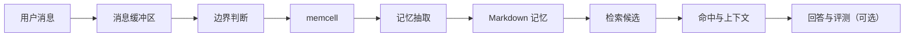

# EverOS MemTrace：开发者接入指南

MemTrace 是我们ZJUNLP实验室的工作，它相当于是为 EverOS 增加了一条可回看的“记忆流水线”。这个pipeline把一次对话从写入、整理、保存，到下一次检索和回答的关键数据串起来，并导出为可查看、可合并、可供归因工具消费的执行图。

本文面向需要开发、调试或评估 EverOS 的工程师， 本文内容包括：

1. 这个功能能为 EverOS 带来什么；
2. 如何在本地打开它并找到输出；
3. 如果新增一条记忆路径或检索阶段，应该在哪里补记录。

## 接入EverOS的好处

EverOS 的记忆不是一次简单的“写入数据库”。一条用户消息可能先进入缓冲区，经边界判断后切成 memcell，再抽取为 Episode，落到 Markdown，最后在另一个请求中被检索出来。只看最终的 Markdown 或搜索结果，很难判断错误发生在哪一步。这也是MemTrace的核心功能。

MemTrace 把这些步骤放在同一条可追溯链上：



这对 EverOS 的实际价值是：

| 价值 | 对开发者意味着什么 |
| --- | --- |
| 更快定位记忆问题 | 可以区分“没有正确抽取”“被更新或删除”“没有召回”和“回答阶段使用错误上下文”，减少只看日志猜原因的时间。 |
| 让 Markdown 记忆可解释 | EverOS 的 Markdown 仍是事实来源；执行图补充“这条记忆如何产生、何时被引用”的来路，不替代 Markdown、SQLite 或 LanceDB。 |
| 支持质量回归 | 同一份图可以复盘失败问答、比较候选池变化，并交给 MemTrace 做错误归因。 |
| 降低插桩成本 | 业务层只提交真实的输入、输出和依赖；`smartcomment` 负责图、版本和导出，开发者不需要自己维护一套 trace JSON。 |
| 对线上路径友好 | 这是可选能力。没有 `smartcomment` 或关闭开关时，hook 退化为 no-op；采集失败也不会让记忆请求失败。 |

## 先用起来

### 安装与开关

在 EverOS checkout 中安装可选依赖：

```bash
uv sync --frozen --extra memtrace
```

MemTrace 默认关闭，只在需要时按进程打开：

```bash
export EVEROS_MEMTRACE_ENABLED=1
```

只用于调试和评测，不要在生产环境打开：每次 `/memory/add`、`/memory/flush`、`/memory/search` 返回前都会在一把进程级锁里对比整个记忆根，耗时随 Markdown 文件数增长，并发请求会互相等待；导出的图保留消息原文和记忆正文，`/memory/delete` 和清空数据（purge）都不会删除导出目录，需要自行删除。详见 [memtrace-graphs.md](memtrace-graphs.md#enabling-tracing)。

图默认写到 `<memory-root>/memtrace/`。调试时可以指定一个独立目录：

```bash
export EVEROS_MEMTRACE_ENABLED=1
export EVEROS_MEMTRACE_DIR=/tmp/everos-memtrace
```

启动 EverOS，正常执行几次 `/memory/add`、`/memory/flush` 和 `/memory/search`。请求结束后，在上述目录中可以看到一个或多个 `.json` 图文件。服务关闭时，API lifespan 会再做一次同步，补上最后的 Markdown 变化。

### 用图做一次本地检查

这个可以先把图导出为 PNG，快速确认消息、记忆和检索结果是否连得起来：

```bash
.venv/bin/python examples/memtrace/export_png.py \
  /tmp/everos-memtrace --out /tmp/everos-memtrace-png
```

默认每个 query 输出一张图，并只展示候选池的前两项；源 JSON 不会被修改。需要展示完整候选池时，加 `--top-k 0`；需要一张总图时，加 `--combined`。

### 把失败问答交给归因工具

`/memory/search` 只负责返回记忆，不负责生成最终答案。因此回答和评测需要由调用方补录。HTTP 实验通常在服务停止后执行：

```bash
.venv/bin/python examples/memtrace/inject_qa.py \
  --graph-dir /tmp/everos-memtrace \
  --qa-results /path/to/qa_results.json

.venv/bin/python examples/memtrace/merge.py /tmp/everos-memtrace \
  --output /tmp/everos-merged.json

.venv/bin/python examples/memtrace/attribute.py \
  --graph /tmp/everos-merged.json --list-cases
```

`inject_qa.py` 会把 prompt（可选）、实际回答、参考答案和 judge 结果接到对应的 query 上。`merge.py` 用于合并构建和检索图；不要把合并结果写回输入目录。更多归因参数见 [examples/memtrace/README.md](../examples/memtrace/README.md)。

## 当前会记录什么

记录点集中在用户真正会关心的业务边界，而不是把每个函数调用都写进图里。

| 场景 | 图中会看到什么 | 适合回答的问题 |
| --- | --- | --- |
| `/memory/add` | 输入消息、缓冲区变化、边界结果、memcell、Episode 抽取结果、成功落盘的记忆 | 这条消息有没有被接收、切分和抽取？ |
| `/memory/flush` | 剩余缓冲区、最终边界结果、flush 请求，即使本次没有新文件也会留下请求记录 | 为什么这批消息仍未形成记忆？ |
| `/memory/search` | query、稀疏/稠密/融合等候选池、实际命中、检索上下文、未处理消息分支 | 记忆是没有生成，还是没有被召回？哪一步改变了候选？ |
| Markdown 观察 | Episode、atomic fact、foresight、agent case、profile、skill 和 knowledge 文件的新增、修改、删除 | 磁盘上的事实何时变化？ |
| 请求失败 | add、flush、search 的失败状态和有限的错误信息；搜索失败会保留已收集的候选阶段 | 请求失败前已经走到哪一步？ |
| 回答与评测（可选） | prediction、参考答案、judge response，以及回答实际使用的上下文 | 错误是检索问题，还是回答阶段的问题？ |

构建和搜索图按 `app_id`、`project_id`、owner、session bucket 分区。相同业务对象使用稳定 identity，内容变化会形成新版本，因此可以看到一条记忆的演变，而不是只有最后状态。

## 怎么读一张图

不需要先掌握 smartcomment 的内部 schema。：

1. **先找 query 或输入消息。** 它们是这次请求的起点。
2. **沿着箭头看业务链。** 常见路径是“消息 → buffer → boundary result → memcell → 抽取结果 → Markdown 记忆 → 候选池 → hit → context”。
3. **再看版本和来源。** `construction_event` 表示在业务步骤中现场捕获；`file_diff` 表示请求结束时扫描 Markdown 发现的变化，只能证明“观察到变化”，不能证明是哪一个请求造成的。
4. **最后看回答链。** 只有调用方补录了实际回答和评测，图中才会出现 prediction、golden answers 和 judge response。

候选池是阶段快照，默认只保存最多 50 个 ID、分数和来源，同时保存 `total_count` 与 `truncated`。所以“图里没有某个候选”不等于“它从未被召回”。命中（hit）是本次 query 的结果；持久记忆是它引用的历史版本，两者不要混为一谈。

空结果、跳过、失败和没有采集到是不同情况。例如：

- `deferred` 表示消息先进入缓冲区，暂不做边界判断和抽取；
- `no_split` 表示本次没有切出 memcell，仍应有结果节点；
- `status: error` 表示请求失败，业务异常仍会继续抛出；
- 没有节点可能只是路径尚未接入，不能直接当成“没有执行”。

## smartcomment 快速介绍

`smartcomment` 是我们开发的一个执行图记录器，不会自动拦截 EverOS 的所有函数、文件写入或 LLM 调用（相当于是插桩）。EverOS 在真实业务边界显式声明：

- **变量**：消息、buffer、记忆、候选池、context 等业务数据；
- **操作**：add、boundary detection、extraction、retrieval、update、deletion 等业务步骤；
- **依赖边**：说明哪个输入产生了哪个输出；
- **版本**：说明同一条记忆或 buffer 如何变化。

图最终以 smartcomment 的 JSON 格式导出，既可以用 `ExecNetwork.import_graph()` 读取，也可以交给 MemTrace 的图探索和归因工具。EverOS 的 `MemTraceTracker` 负责请求分组、Markdown 扫描、重启恢复、文件锁和导出；业务代码只需要通过 tracker 或 trace collector 提交数据。

## 运行成本与边界

- **它不是零成本日志。** add、flush、search 请求结束时会扫描 memory root，并对脏图做序列化；启用后会增加一定延迟和磁盘占用。
- **它不是完整录屏。** 当前不会自动保存所有 LLM prompt、原始 response、每轮 retry、OME 内部演化、LanceDB/embedding 的每个索引步骤，也不会自动记录回答模型。
- **文件差分是后验观察。** 两次扫描之间发生又被覆盖的中间状态可能不可见；`file_diff` 不能单独证明因果关系。
- **多进程需要规划写入方式。** 文件锁可以避免导出文件写坏，但不会合并不同 worker 的内存图。生产环境请选择单写者，或为每个 worker 指定独立的 `EVEROS_MEMTRACE_DIR`。
- **图可能包含正文。** 消息、记忆和回答内容可能出现在 JSON 中。共享图或提交 issue 前，请按数据敏感级别设置目录权限并做好脱敏。

如果项目只需要 EverOS 的正常记忆能力，可以不安装 `memtrace` extra，核心路径照常运行。安装并启用它的主要收益，是在出现“记忆为什么不对”或“回答为什么错”时，多一条可以复盘的证据链。

## 验证改动

在 EverOS checkout 中运行与本功能最相关的测试：

```bash
.venv/bin/python -m pytest -q \
  tests/unit/test_service/test_memorize_memtrace_hook.py \
  tests/unit/test_memory/test_extract/test_trace.py \
  tests/unit/test_memory/test_search/test_trace.py \
  tests/unit/test_infra/test_memtrace_no_split.py \
  tests/unit/test_infra/test_memtrace_boundary_decision.py \
  tests/unit/test_infra/test_memtrace_buffer_lifecycle.py \
  tests/unit/test_infra/test_memtrace_regressions.py
```

新增插桩后，至少补充一条对应的成功、空结果或失败测试，并检查导出的 JSON 能被 `smartcomment.runtime.ExecNetwork.import_graph()` 重新读取。更完整的图归因示例见 [memtrace-graphs.md](memtrace-graphs.md)，历史审阅记录见 [memtrace-attribution-review.zh-CN.md](memtrace-attribution-review.zh-CN.md)。
